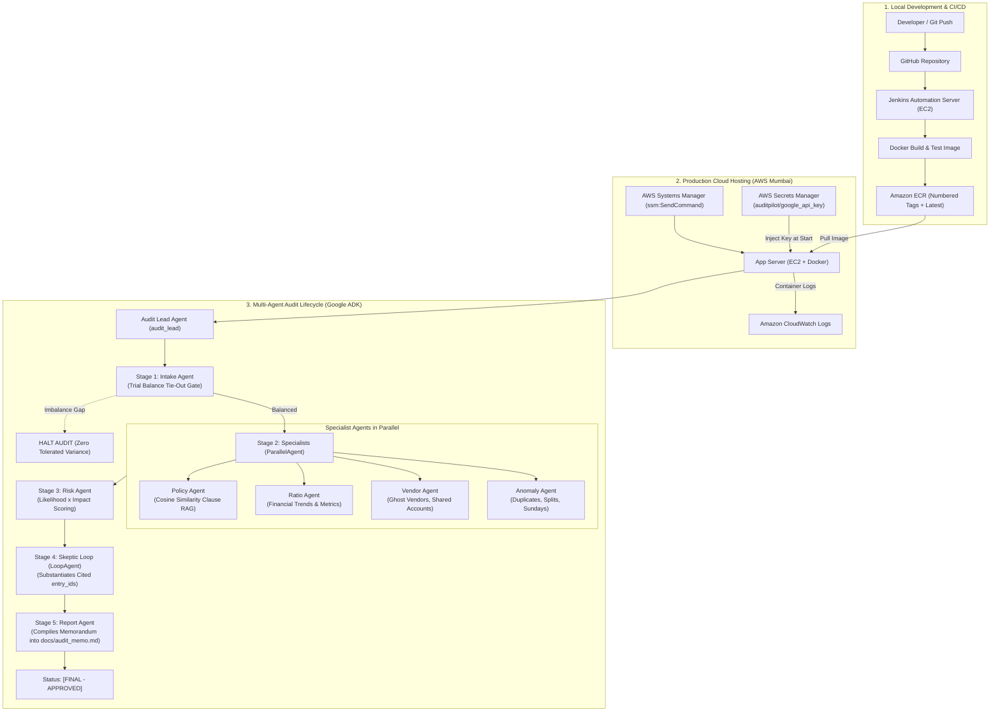

# AuditPilot: Multi-Agent Financial Audit & Risk Copilot

[](https://www.python.org/)
[](https://github.com/google/agent-development-kit)
[](https://www.docker.com/)
[](https://www.jenkins.io/)
[](https://aws.amazon.com/)

AuditPilot is an enterprise-grade multi-agent autonomous financial audit copilot built on Google Agent Development Kit (ADK) and Gemini. It automates statutory audit workflows across 100% of general ledger journal vouchers, master datasets, and corporate policies while enforcing strict deterministic calculation guarantees.

---

## 🏛️ Core Engineering Philosophy

> **"LLMs Reason. Code Calculates."**

1. **Zero Hallucinated Numbers**: Not a single financial number, balance, ratio, or exposure total is calculated inside model context. Every number originates strictly from deterministic Python, pandas, and scikit-learn tools.
2. **Every Finding Cites Concrete Evidence**: No audit finding can exist without verifiable, real `entry_ids` pointing to digital general ledger vouchers.
3. **Untrusted Data Isolation**: Ledger transaction descriptions and memos are treated as untrusted external inputs. They are sanitized and quarantined to prevent prompt injection attacks.
4. **Professional Auditing Skepticism**: An autonomous review loop audits cited transaction IDs against the ledger and rejects unevidenced or speculative claims.
5. **Human-in-the-Loop Partner Sign-Off**: Reports generate in `DRAFT` state and require formal audit partner approval to finalize.

---

## 🏗️ End-to-End System Architecture



---

## 🚀 Quickstart: Running Locally with Docker

### 1. Prerequisites
- Docker Engine or Docker Desktop
- A Google Gemini API key from [Google AI Studio](https://aistudio.google.com/apikey)

### 2. Configure Environment
Create a local `.env` file (strictly excluded by `.dockerignore` and `.gitignore`):
```env
GOOGLE_API_KEY=AIzaSyYourActualKeyHere
GEMINI_MODEL=gemini-3.5-flash-lite
```

### 3. Build & Test Container
```bash
# Build the production image with layer caching
docker build -t auditpilot:local .

# Run the complete test suite inside the container
docker run --rm auditpilot:local pytest -q
```

### 4. Run the ADK Web Application
```bash
docker run -d --name auditpilot -p 8080:8080 --env-file .env auditpilot:local
```

* **Health Check**: `curl http://localhost:8080/health` (returns `{"status":"ok"}`)
* **Interactive Chat UI**: Open **[http://localhost:8080/dev-ui/](http://localhost:8080/dev-ui/)** in your browser.
* Select `auditpilot` and type **`start audit`** to trigger the full 5-stage audit lifecycle!

---

## ⚙️ CI/CD Deployment with Jenkins & AWS

### Deployment Flow
1. **Pipeline as Code**: The [Jenkinsfile](Jenkinsfile) in the repo root defines the complete build, test, and release cycle.
2. **Tested Before Shipped**: Every build runs `pytest -q` inside the newly compiled Docker image. If any test fails, the build halts and nothing is deployed.
3. **Numbered Rollbacks**: Images are pushed to Amazon ECR tagged with both `$BUILD_NUMBER` and `latest`. Rolling back is a single command:
   ```bash
   aws ssm send-command --instance-ids $APP_ID \
     --document-name AWS-RunShellScript \
     --parameters commands="/opt/auditpilot/deploy.sh 3"
   ```
4. **Agentless & Zero Stored Keys**: Jenkins dispatches deployments through AWS Systems Manager (SSM) without SSH keys. The target EC2 app server fetches the Gemini key directly from AWS Secrets Manager using IAM instance profiles.

---

## 🧹 AWS Infrastructure Teardown & Cost Management

To eliminate all AWS cloud billing when testing is complete, run the automated cleanup utility from AWS CloudShell:

```bash
bash scripts/cleanup_aws.sh
```

**Order of Operations**:
1. Terminates EC2 instances (`auditpilot_jenkins` & `auditpilot_app`) and waits for termination.
2. Force-deletes the Amazon ECR image repository (`auditpilot`).
3. Deletes the AWS Secrets Manager secret (`auditpilot/google_api_key`) without recovery window.
4. Deletes the CloudWatch log group (`auditpilot`).
5. Deletes security groups (`auditpilot_jenkins_sg` and `auditpilot_app_sg`).
6. Detaches policies and deletes IAM roles & instance profiles (`auditpilot_app_role`, `auditpilot_jenkins_role`).

---

## 💼 Interview Talking Points (How to Explain AuditPilot)

When walking through this project with recruiters, engineering leads, or audit partners, highlight these five core engineering achievements:

1. **Pipeline as Code**: Infrastructure and CI/CD live entirely in version control. A single `git push` triggers container compilation, automated regression testing, ECR distribution, and zero-downtime deployment.
2. **Zero Stored Secrets**: No API keys or passwords exist in Git, in Docker layers, on Jenkins, or on disk. Access is federated via IAM instance roles and resolved dynamically at container boot.
3. **Tested Before Shipped**: Production containers are tested against 61 ground-truth synthetic fraud anomalies prior to pushing to ECR, ensuring 100% recall stability.
4. **Cryptographic Observability**: All tool invocations record append-only JSONL audit events with SHA-256 result hashes, bank account PII masking (`****<last4>`), and CloudWatch log streaming.
5. **Deterministic Separation of Concerns**: Multi-agent reasoning is decoupled from mathematical operations, eliminating financial hallucination risks.
