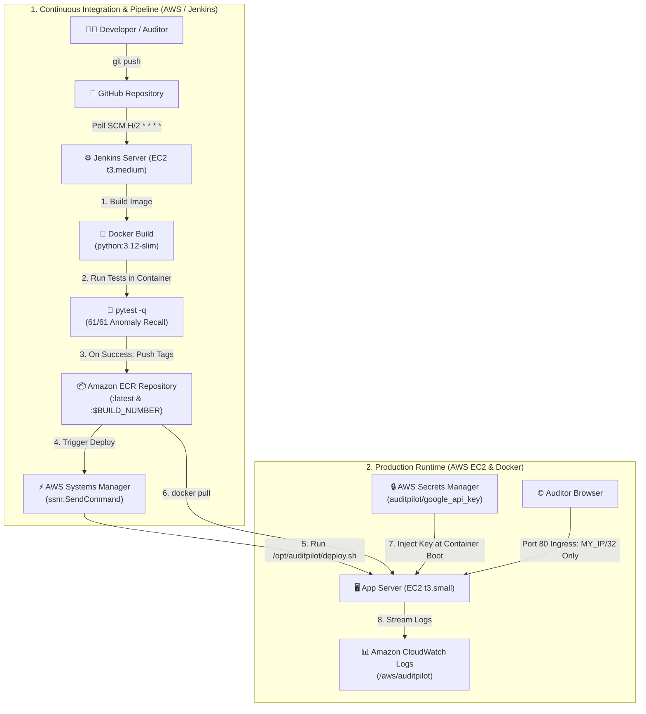
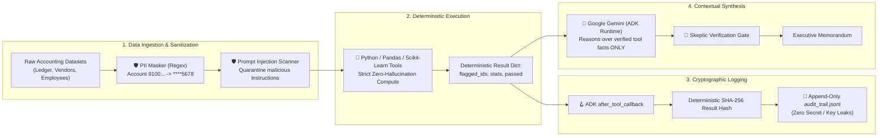

# AuditPilot: Multi-Agent Financial Audit & Risk Copilot

[](https://www.python.org/)
[](https://github.com/google/agent-development-kit)
[](https://www.docker.com/)
[](https://www.jenkins.io/)
[](https://aws.amazon.com/)

AuditPilot is an enterprise-grade multi-agent autonomous financial audit copilot built on Google Agent Development Kit (ADK) and Gemini. It automates statutory audit workflows across 100% of general ledger journal vouchers, master datasets, and corporate policies while enforcing strict deterministic calculation guarantees.

---

## 🏛️ Core Engineering Philosophy

> **"LLMs Reason. Code Calculates."**

1. **Zero Hallucinated Numbers**: Not a single financial number, balance, ratio, or exposure total is calculated inside model context. Every number originates strictly from deterministic Python, pandas, and scikit-learn tools.
2. **Every Finding Cites Concrete Evidence**: No audit finding can exist without verifiable, real `entry_ids` pointing to digital general ledger vouchers.
3. **Untrusted Data Isolation**: Ledger transaction descriptions and memos are treated as untrusted external inputs. They are sanitized and quarantined to prevent prompt injection attacks.
4. **Professional Auditing Skepticism**: An autonomous review loop audits cited transaction IDs against the ledger and rejects unevidenced or speculative claims.
5. **Human-in-the-Loop Partner Sign-Off**: Reports generate in `DRAFT` state and require formal audit partner approval to finalize.

---

## 🏗️ System Architecture Diagrams

### 1. Cloud Infrastructure & CI/CD Deployment Architecture
AuditPilot runs an automated "push-to-deploy" pipeline on AWS. Every change pushed to GitHub is automatically tested, containerized, stored in ECR, and deployed to EC2 via AWS Systems Manager without requiring SSH keys or storing credentials in code.



---

### 2. Multi-Agent Orchestration DAG (Google ADK)
The multi-agent core is structured as a hierarchical directed acyclic graph (DAG) coordinated by the Lead Auditor agent with sequential gating, parallel specialist analysis, and an iterative skepticism loop.

```mermaid
flowchart TD
    USER["Auditor Prompt: 'start audit'"] --> LEAD["👑 Audit Lead Agent\n(audit_lead)"]
    
    subgraph Stage1_Intake ["Stage 1: Intake Gatekeeper"]
        LEAD --> INTAKE["🚪 Intake Agent\n(intake_agent)"]
        INTAKE --> T1["🔧 load_ledger()"]
        INTAKE --> T2["🔧 check_trial_balance()"]
        T2 --> GATE{"Is Trial Balance\nBalanced?"}
        GATE -->|No: Gap Detected| HALT["⛔ HALT AUDIT\n(Zero Tolerance for Imbalance)"]
    end

    subgraph Stage2_Specialists ["Stage 2: Parallel Specialist Investigations"]
        GATE -->|Yes: Reconciled| PARALLEL["⚡ specialists (ParallelAgent)"]
        
        PARALLEL --> ANOMALY["🔍 Anomaly Agent\n(anomaly_findings)"]
        ANOMALY --> T_DUP["find_duplicates()"]
        ANOMALY --> T_SPLIT["find_split_payments()"]
        ANOMALY --> T_SUN["find_weekend_round()"]
        ANOMALY --> T_INJ["scan_untrusted_descriptions()"]
        ANOMALY --> T_BEN["benford_test()"]

        PARALLEL --> VENDOR["🏢 Vendor Agent\n(vendor_findings)"]
        VENDOR --> T_GHOST["find_ghost_vendors()"]
        VENDOR --> T_BANK["vendor_bank_overlap()"]

        PARALLEL --> RATIO["📈 Ratio Agent\n(ratio_findings)"]
        RATIO --> T_RATIO["ratio_table()"]

        PARALLEL --> POLICY["📜 Policy Agent\n(policy_findings)"]
        POLICY --> T_POL["retrieve_policy() (Cosine TF-IDF RAG)"]
        POLICY --> T_SOD["check_approval_limits()"]
    end

    subgraph Stage3_Risk ["Stage 3: Deterministic Risk Scoring"]
        PARALLEL --> RISK["⚖️ Risk Agent\n(score_and_rank_findings)"]
        RISK --> MATH["Python Calculation:\nScore = Likelihood (1-5) * Impact (1-5)"]
    end

    subgraph Stage4_Skeptic ["Stage 4: Professional Skepticism Loop"]
        MATH --> LOOP["🔁 skeptic_loop (LoopAgent, max 3 rounds)"]
        LOOP --> SKEPTIC["🧐 Skeptic Agent\n(skeptic_agent)"]
        SKEPTIC --> VERIFY["🔧 verify_entry_ids()"]
        VERIFY --> SKEP_CHECK{"All cited entry_ids\nsubstantiated in ledger?"}
        SKEP_CHECK -->|No Evidence| DROP["🗑️ Move to dropped_findings\n(with rationale)"]
        SKEP_CHECK -->|Evidence Confirmed| KEEP["✅ Confirmed Audit Finding"]
    end

    subgraph Stage5_Reporting ["Stage 5: Reporting & Human Sign-Off"]
        KEEP --> REPORT["📝 Report Agent\n(report_agent)"]
        REPORT --> MEMO_GEN["generate_audit_memo()"]
        MEMO_GEN --> DRAFT["📄 docs/audit_memo.md\nSTATUS: [DRAFT - PENDING APPROVAL]"]
        DRAFT --> PARTNER{"Audit Partner\nReview & Sign-Off"}
        PARTNER -->|approve_audit_memo()| FINAL["🏁 STATUS: [FINAL - APPROVED]"]
    end
```

---

### 3. Security, Privacy & Anti-Hallucination Pipeline
AuditPilot enforces multi-layered guardrails ensuring that raw sensitive banking coordinates never enter model prompts, untrusted text cannot execute prompt injections, and every number is traceable to deterministic code.



---

## 🚀 Quickstart: Running Locally with Docker

### 1. Prerequisites
- Docker Engine or Docker Desktop
- A Google Gemini API key from [Google AI Studio](https://aistudio.google.com/apikey)

### 2. Configure Environment
Create a local `.env` file (strictly excluded by `.dockerignore` and `.gitignore`):
```env
GOOGLE_API_KEY=AIzaSyYourActualKeyHere
GEMINI_MODEL=gemini-3.5-flash-lite
```

### 3. Build & Test Container
```bash
# Build the production image with layer caching
docker build -t auditpilot:local .

# Run the complete test suite inside the container
docker run --rm auditpilot:local pytest -q
```

### 4. Run the ADK Web Application
```bash
docker run -d --name auditpilot -p 8080:8080 --env-file .env auditpilot:local
```

* **Health Check**: `curl http://localhost:8080/health` (returns `{"status":"ok"}`)
* **Interactive Chat UI**: Open **[http://localhost:8080/dev-ui/](http://localhost:8080/dev-ui/)** in your browser.
* Select `auditpilot` and type **`start audit`** to trigger the full 5-stage audit lifecycle!

---

## ⚙️ CI/CD Deployment with Jenkins & AWS

### Deployment Flow
1. **Pipeline as Code**: The [Jenkinsfile](Jenkinsfile) in the repo root defines the complete build, test, and release cycle.
2. **Tested Before Shipped**: Every build runs `pytest -q` inside the newly compiled Docker image. If any test fails, the build halts and nothing is deployed.
3. **Numbered Rollbacks**: Images are pushed to Amazon ECR tagged with both `$BUILD_NUMBER` and `latest`. Rolling back is a single command:
   ```bash
   aws ssm send-command --instance-ids $APP_ID \
     --document-name AWS-RunShellScript \
     --parameters commands="/opt/auditpilot/deploy.sh 3"
   ```
4. **Agentless & Zero Stored Keys**: Jenkins dispatches deployments through AWS Systems Manager (SSM) without SSH keys. The target EC2 app server fetches the Gemini key directly from AWS Secrets Manager using IAM instance profiles.

---

## 🧹 AWS Infrastructure Teardown & Cost Management

To eliminate all AWS cloud billing when testing is complete, run the automated cleanup utility from AWS CloudShell:

```bash
bash scripts/cleanup_aws.sh
```

**Order of Operations**:
1. Terminates EC2 instances (`auditpilot_jenkins` & `auditpilot_app`) and waits for termination.
2. Force-deletes the Amazon ECR image repository (`auditpilot`).
3. Deletes the AWS Secrets Manager secret (`auditpilot/google_api_key`) without recovery window.
4. Deletes the CloudWatch log group (`auditpilot`).
5. Deletes security groups (`auditpilot_jenkins_sg` and `auditpilot_app_sg`).
6. Detaches policies and deletes IAM roles & instance profiles (`auditpilot_app_role`, `auditpilot_jenkins_role`).

---

## 💼 Interview Talking Points (How to Explain AuditPilot)

When walking through this project with recruiters, engineering leads, or audit partners, highlight these five core engineering achievements:

1. **Pipeline as Code**: Infrastructure and CI/CD live entirely in version control. A single `git push` triggers container compilation, automated regression testing, ECR distribution, and zero-downtime deployment.
2. **Zero Stored Secrets**: No API keys or passwords exist in Git, in Docker layers, on Jenkins, or on disk. Access is federated via IAM instance roles and resolved dynamically at container boot.
3. **Tested Before Shipped**: Production containers are tested against 61 ground-truth synthetic fraud anomalies prior to pushing to ECR, ensuring 100% recall stability.
4. **Cryptographic Observability**: All tool invocations record append-only JSONL audit events with SHA-256 result hashes, bank account PII masking (`****<last4>`), and CloudWatch log streaming.
5. **Deterministic Separation of Concerns**: Multi-agent reasoning is decoupled from mathematical operations, eliminating financial hallucination risks.
